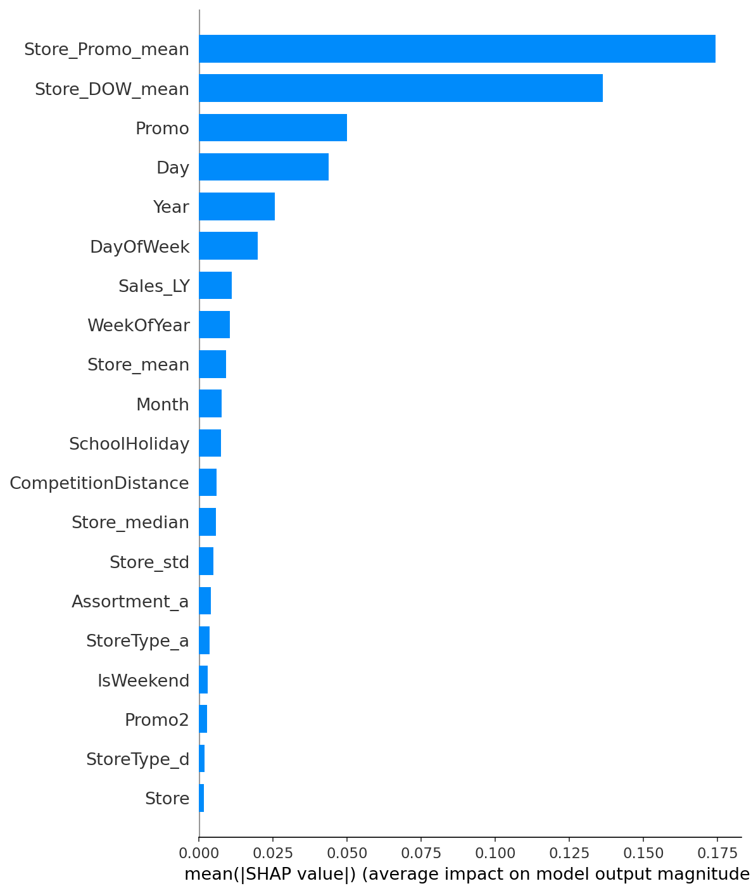
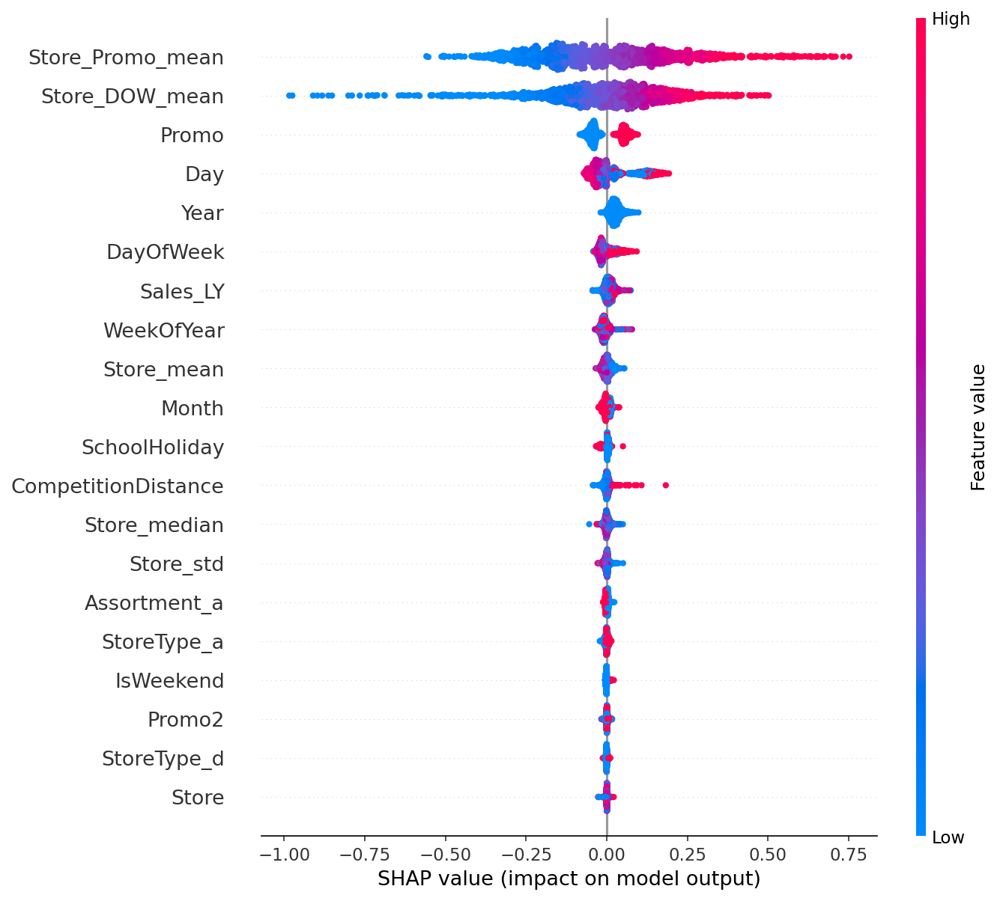
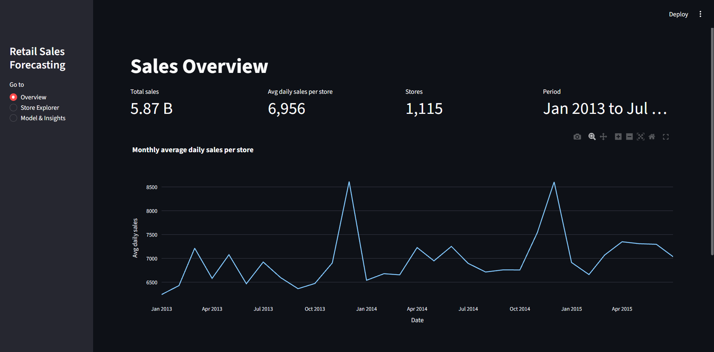
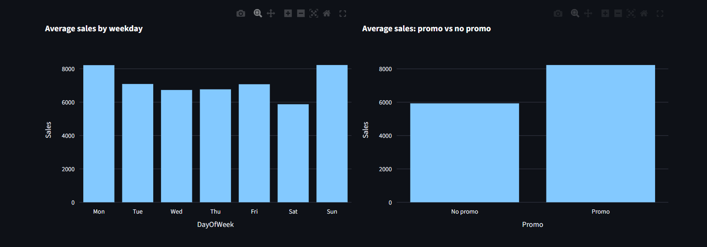
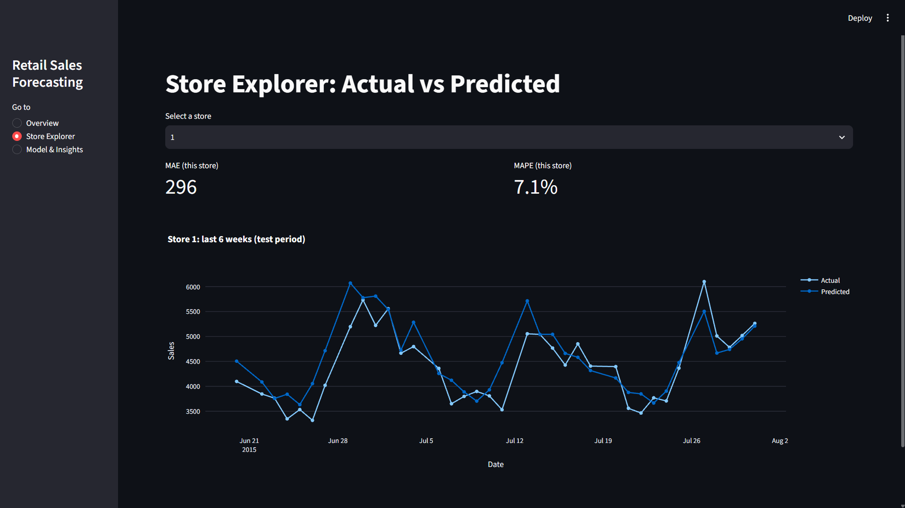
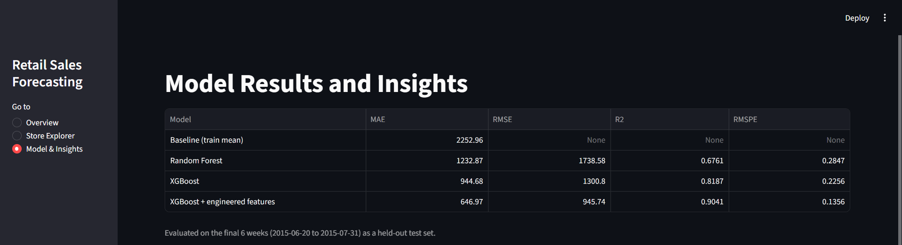
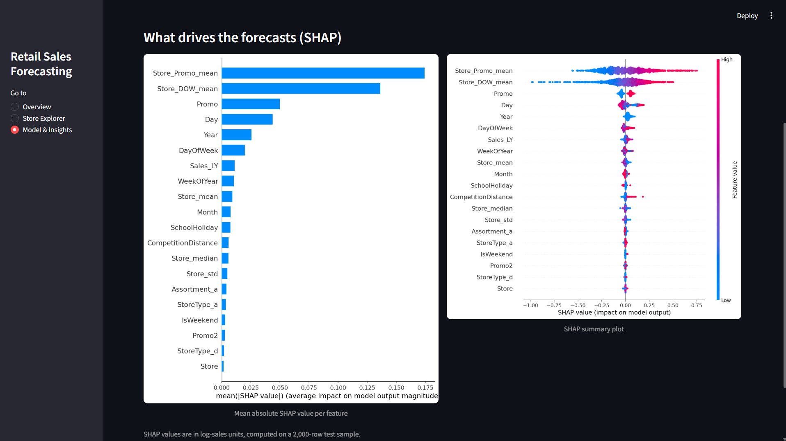

# Retail Sales Analytics & Demand Forecasting

## Project Overview

A collaborative Data Science project that analyzes historical retail sales and forecasts daily store-level sales using Machine Learning, built on the Kaggle [Rossmann Store Sales](https://www.kaggle.com/c/rossmann-store-sales) dataset.

## Technologies

* Python
* MySQL
* Pandas & NumPy
* Matplotlib & Seaborn
* Scikit-learn
* XGBoost
* SHAP
* Streamlit

## Project Objectives

* Analyze historical retail sales.
* Perform SQL-based business analysis.
* Identify sales trends and patterns.
* Compare Random Forest and XGBoost for store-level daily sales forecasting.
* Explain model predictions using SHAP.
* Develop an interactive Streamlit dashboard.

## Dataset

* Rossmann Store Sales (Kaggle): daily sales for 1,115 stores from 2013-01-01 to 2015-07-31, with promotions, holidays, store type, assortment and competition details. Download `train.csv`, `test.csv` and `store.csv` into `data/raw/` (not included in this repo).

## Methodology

* Removed closed-store and zero-sales days, then merged `train` with `store`
* Chronological split: train 2013-01-01 to 2015-06-19, test the final 6 weeks
* Compared Random Forest and XGBoost against a train-mean baseline
* Engineered features: store-level averages from the training period, same-weekday sales one year earlier, a state holiday flag, and a log-transformed target

## Results

| Model | MAE | RMSE | R² | RMSPE |
|---|---:|---:|---:|---:|
| Baseline (train mean) | 2252.96 | n/a | n/a | n/a |
| Random Forest | 1232.87 | 1738.58 | 0.6761 | 0.2847 |
| XGBoost | 944.68 | 1300.80 | 0.8187 | 0.2256 |
| XGBoost + engineered features | 646.97 | 945.74 | 0.9041 | 0.1356 |

*Evaluated on the final 6 weeks (2015-06-20 to 2015-07-31) as a held-out test set.*

## Key Insights (SHAP)




*SHAP values are in log-sales units, computed on a 2,000-row sample of the test set.*

1. **Store-level patterns drive forecasts.** Each store's average sales with and without promotions, and by weekday, are the strongest predictors.
2. **Promotions have a clear, consistent lift.** Promo days push predictions up and non-promo days push them down.
3. **Weekday matters, calendar and competition effects are smaller.** Month, school holidays and competition distance contribute modestly.

## Dashboard

**Overview**




**Store Explorer**



**Model and Insights**




## How to Run

```bash
git clone https://github.com/deshmukhom2712-beep/Retail-Sales-Forecasting.git
cd Retail-Sales-Forecasting
python -m venv venv
venv\Scripts\activate
pip install -r requirements.txt
```

1. Download the dataset into `data/raw/`.
2. Run the notebooks in `notebooks/` in order. This generates the model and `data/test_predictions.parquet`.
3. Launch the dashboard: `streamlit run dashboard/streamlit_app.py`

## Project Structure

```
├── data/raw/        # Kaggle CSVs (gitignored)
├── notebooks/       # data understanding, baseline models, SHAP
├── reports/figures/ # SHAP plots and dashboard screenshots
├── dashboard/       # Streamlit app
├── sql/             # schema and business queries
└── README.md
```

## Team

* Om Deshmukh: data cleaning, EDA, machine learning, evaluation
* Anish Thorat: MySQL database design and SQL analysis

## Project Status

🚧 In Development
